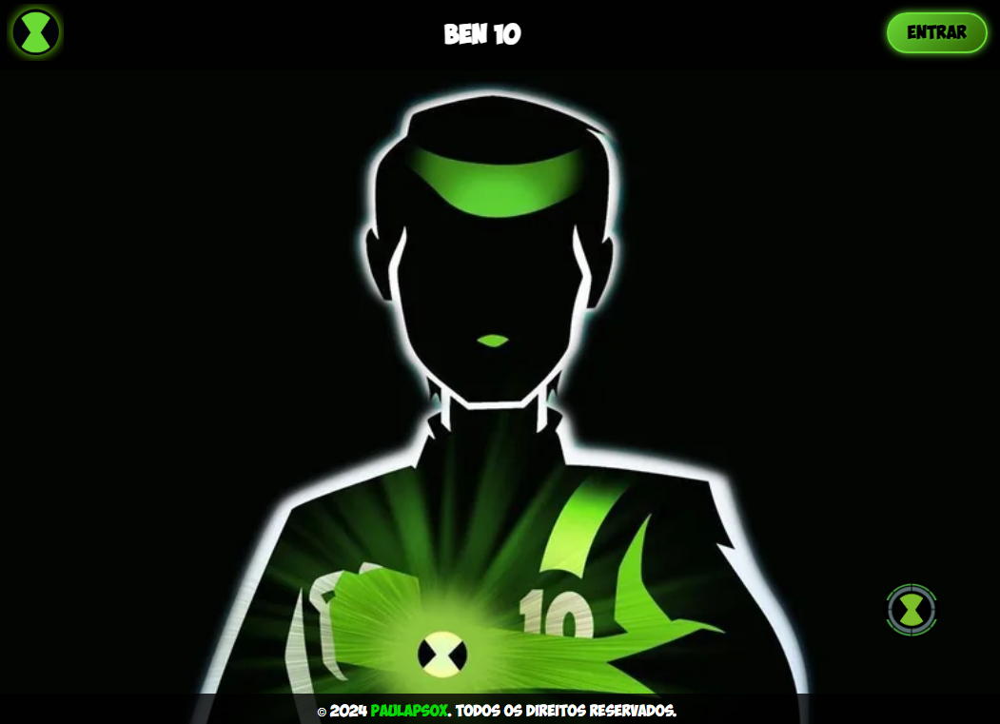
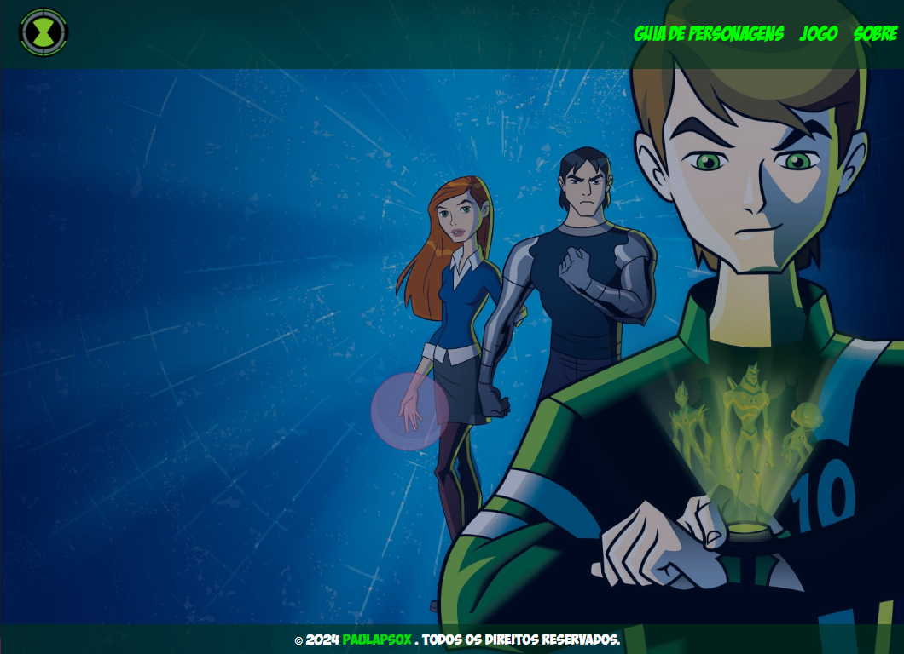
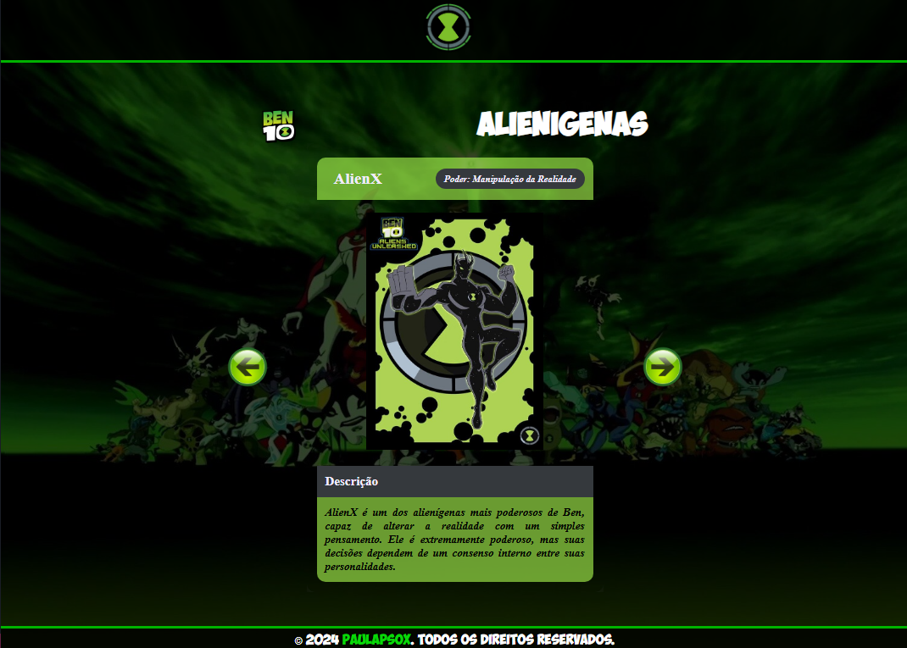
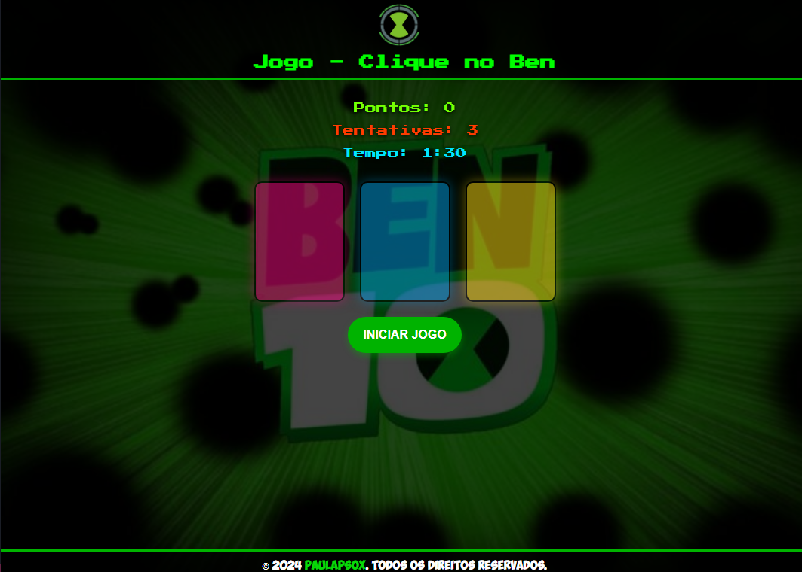
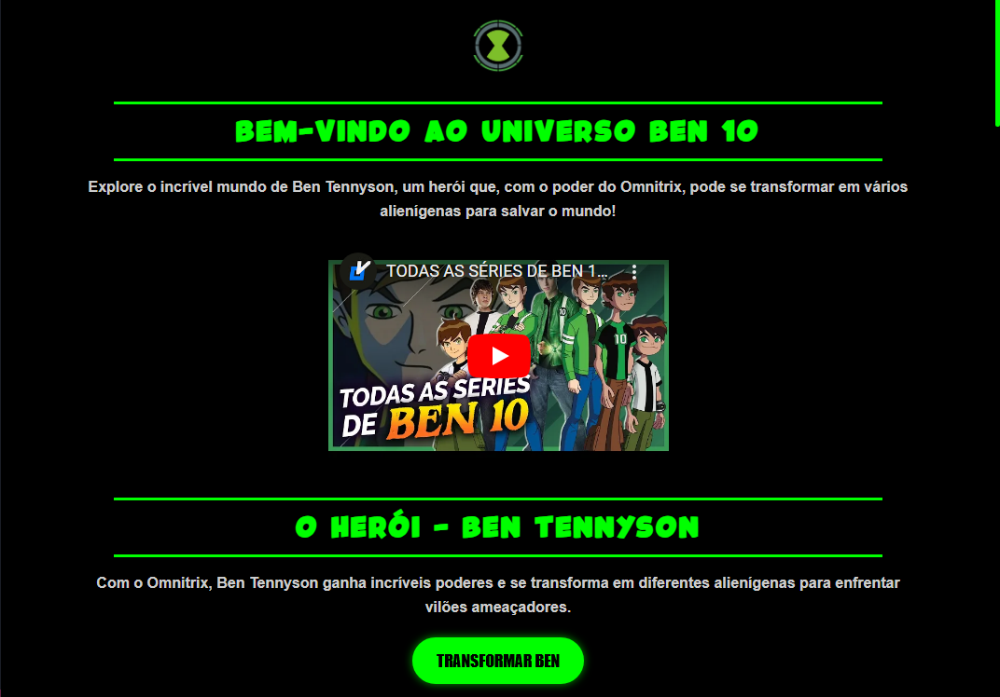
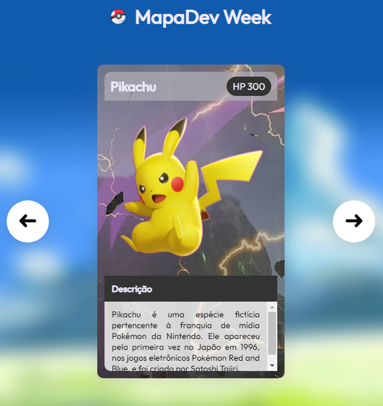

<div align="center">



<br><br>

# ⌚ BEN 10 · O UNIVERSO INCRÍVEL

**Um Omnitrix no navegador: menu radial, guia de alienígenas e um jogo para achar o Ben.**<br>
HTML5 · CSS3 · JavaScript puro — sem frameworks, sem build.

<p>
  
  
  
</p>

<p>
  <a href="https://paulapsox.github.io/ben-10/">
    
  </a>
  <a href="https://github.com/paulaPSOx/ben-10">
    
  </a>
</p>

</div>

---

## ⚡ Em 30 segundos

| | |
| :-- | :-- |
| **O que é** | Site de 5 páginas sobre o universo Ben 10: Omnitrix interativo na home, guia com 19 alienígenas, minijogo "Clique no Ben" e página sobre a série. |
| **Para quê** | Praticar manipulação do DOM, eventos, temporizadores, sorteio aleatório e layout com CSS puro. Feito para o desafio da comunidade Dev Em Dobro (Mapa Dev Week). |
| **Destaque** | O menu radial do Omnitrix: os alienígenas são posicionados em arco com seno e cosseno, direto no JavaScript. |
| **Stack** | HTML5, CSS3 e JavaScript puro. |
| **Online** | [paulapsox.github.io/ben-10](https://paulapsox.github.io/ben-10/) |

---

## ⌚ Modo Omnitrix: as telas

<table>
  <tr>
    <td width="50%" valign="top">
      <a href="https://paulapsox.github.io/ben-10/">
        
      </a>
      <p align="center"><strong>1 · Home</strong><br>Omnitrix clicável e botão Entrar.</p>
    </td>
    <td width="50%" valign="top">
      <a href="https://paulapsox.github.io/ben-10/menu.html">
        
      </a>
      <p align="center"><strong>2 · Menu</strong><br>Três caminhos: Guia, Jogo e Sobre.</p>
    </td>
  </tr>
  <tr>
    <td width="50%" valign="top">
      <a href="https://paulapsox.github.io/ben-10/guia-personagens.html">
        
      </a>
      <p align="center"><strong>3 · Guia de Personagens</strong><br>Carrossel de cards com nome, poder e descrição.</p>
    </td>
    <td width="50%" valign="top">
      <a href="https://paulapsox.github.io/ben-10/jogo.html">
        
      </a>
      <p align="center"><strong>4 · Jogo</strong><br>Três cartas, pontos, tentativas e tempo.</p>
    </td>
  </tr>
  <tr>
    <td colspan="2" align="center" valign="top">
      <a href="https://paulapsox.github.io/ben-10/sobre.html">
        
      </a>
      <p align="center"><strong>5 · Sobre</strong><br>Vídeos, personagens, vilões e o botão Transformar Ben.</p>
    </td>
  </tr>
</table>

> 💡 **Dica para quem for testar:** na home, clique no Omnitrix e passe o mouse sobre os alienígenas. No jogo, as cartas mudam a cada 0,9 segundo. Na página Sobre, clique em **Transformar Ben** e depois na imagem para voltar.

---

## 👽 Alienígenas desbloqueados: funcionalidades

### 🟢 Home · Omnitrix
- Botão do Omnitrix abre um menu radial com 10 alienígenas.
- Sons ao abrir o Omnitrix, ao passar o mouse sobre um alienígena e no desligamento.
- Ao escolher um alienígena, o Omnitrix mostra a imagem dele e depois passa pelas imagens de desligamento, recarga e carregamento antes de voltar ao relógio.
- Enquanto essa sequência roda, o Omnitrix não aceita nova seleção.

### 🧭 Menu
- Links para o Guia de Personagens, o Jogo e a página Sobre.
- Clicar no logo troca a imagem para "recarregando" e leva à home.

### 📖 Guia de Personagens
- Carrossel com 19 cards, um por vez, com nome, poder e descrição.
- Setas de avançar e voltar; do último card volta ao primeiro, e vice-versa.

### 🎮 Jogo · Clique no Ben
- Três cartas sorteadas a cada 0,9 segundo: uma tem o Ben, as outras duas têm personagens diferentes entre si.
- Cada rodada aceita um único clique. Acertou o Ben: +10 pontos. Errou: perde 1 de 3 tentativas.
- O jogo termina ao zerar as tentativas ou os 90 segundos.
- Tela de fim de jogo com pontuação e recorde da sessão. Botões de iniciar e reiniciar.

### ℹ️ Sobre
- Dois vídeos do YouTube incorporados.
- Botão **Transformar Ben** sorteia entre 14 alienígenas sem repetir até a lista acabar. Clicar na imagem devolve o Ben.
- Seções sobre os personagens, o Omnitrix, os vilões (Vilgax, Dr. Animo e Kevin Levin) e curiosidades da série.

> **Observação:** não há backend. O recorde do jogo fica só na memória da página e some ao recarregar.

---

## 🔧 Por dentro do código

Algumas decisões que tomei durante o desenvolvimento:

| Tema | Como foi resolvido |
| :-- | :-- |
| **Menu radial** | `posicionarItensMenu()` (`index.js`) calcula o ângulo de cada item entre `startAngle = -135` e `endAngle = 135`, converte para radianos e usa `Math.cos` e `Math.sin` com `radius = 65` para gerar o `translate` de cada botão. |
| **Estado do Omnitrix** | `isMenuOpen`, `isAlienSelected` e `selectedAlien` controlam o fluxo. Quatro `setTimeout` encadeados (10 s, 3 s, 3 s, 3 s) trocam as imagens e devolvem o Omnitrix ao estado inicial. |
| **Áudio** | `tocarSom()` reinicia o `currentTime` e trata a promessa do `play()` com `catch`, para o navegador não quebrar a página se bloquear o som. |
| **Carrossel circular** | `avançarAlien()` e `voltarAlien()` (`guia-personagens.js`) usam o operador `%` para o índice dar a volta. A classe `selecionado` define qual card aparece. |
| **Sorteio do jogo** | `shuffleCups()` sorteia a carta do Ben e usa `splice` para tirar cada personagem sorteado da lista, então as outras cartas nunca repetem. `setInterval` com `gameSpeed = 900` troca as cartas. |
| **Sorteio sem repetição no Sobre** | Algoritmo Fisher-Yates em `embaralharArray()` e `pop()` para tirar um alienígena por vez. Quando a lista acaba, ela é embaralhada de novo. |
| **Responsividade** | Media queries em `max-width: 768px` nos 5 arquivos CSS, mais `470px` no jogo e `320px` no guia. |

### 🎯 Destaque: o estado do jogo

| Variável ou função | Papel no projeto |
| :-- | :-- |
| `score` | Pontos da partida (+10 por acerto). |
| `attempts` | Tentativas restantes (começa em 3). |
| `timeLeft` | Segundos restantes (começa em 90); `formatTime()` mostra em `M:SS`. |
| `highScore` | Maior pontuação da sessão (não é salva). |
| `gameSpeed` / `gameInterval` | Intervalo de 900 ms entre rodadas e o id do `setInterval`. |
| `roundCompleted` | Trava a rodada depois do primeiro clique. |
| `checkChoice(isBen)` | Soma ponto ou desconta tentativa e atualiza o placar. |
| `endGame()` | Para o intervalo e mostra a tela de fim de jogo. |

---

## 🧬 DNA do projeto: tecnologias

<table>
  <tr>
    <td align="center" width="33%">
      <br>
      <strong>HTML5</strong><br>
      <sub>5 páginas, áudios, vídeos incorporados e <code>lang="pt-br"</code>.</sub>
    </td>
    <td align="center" width="33%">
      <br>
      <strong>CSS3</strong><br>
      <sub>Um CSS por página, fontes locais com <code>@font-face</code> e media queries.</sub>
    </td>
    <td align="center" width="33%">
      <br>
      <strong>JavaScript</strong><br>
      <sub>DOM, eventos, temporizadores e sorteios.</sub>
    </td>
  </tr>
</table>

**Complementos:** Google Fonts (Press Start 2P no jogo, Outfit no guia), fontes locais (Badaboom BB, Obelix Pro e Kids Magazine), vídeos incorporados do YouTube e hospedagem no GitHub Pages.

---

## 🗂️ Estrutura do projeto

```text
ben-10/
├── index.html              # Home com o Omnitrix e o menu radial
├── menu.html               # Menu principal
├── guia-personagens.html   # Carrossel de alienígenas
├── jogo.html               # Jogo "Clique no Ben"
├── sobre.html              # Página sobre a série
├── imagens/                # Prints usados neste README
├── src/
│   ├── css/                # style.css (home) + um CSS por página
│   ├── fonts/              # Badaboom BB, Kids Magazine, Obelix Pro
│   ├── imagem/             # aliens/, cards/, jogo/, setas/ e imagens soltas
│   ├── js/                 # index, menu, guia-personagens, jogo e sobre
│   └── sounds/             # 4 áudios do Omnitrix (.mp3)
├── LICENSE
└── README.md
```

---

## 🚀 Como rodar

Não há dependências nem etapa de build. Escolha uma das opções:

**Opção 1 — Acessar online:** [abrir no GitHub Pages](https://paulapsox.github.io/ben-10/).

**Opção 2 — Baixar o ZIP:** clique em **Code → Download ZIP** neste repositório, extraia e abra o `index.html` no navegador.

**Opção 3 — Clonar com Git:**

```bash
git clone https://github.com/paulaPSOx/ben-10.git
cd ben-10
```

Depois, abra o `index.html` no navegador. Se usar o VS Code, a extensão **Live Server** também funciona.

> Os vídeos do YouTube e as fontes do Google precisam de internet.

---

## 📚 O que este projeto me ensinou

- Posicionar elementos em círculo com seno e cosseno.
- Controlar estado com variáveis e `setTimeout` para impedir ações enquanto uma animação roda.
- Sortear sem repetição com `splice` e com o algoritmo Fisher-Yates.
- Montar um carrossel circular com índice e operador `%`.

---

## 🏁 Próximas transformações

Melhorias que quero fazer, e que **ainda não estão implementadas**:

- [ ] Guardar o id do `setInterval` do cronômetro do jogo e limpá-lo ao reiniciar.
- [ ] Tornar as cartas do jogo acessíveis por teclado (usar `button`, foco visível) e respeitar `prefers-reduced-motion`.
- [ ] Salvar o recorde com `localStorage`.
- [ ] Deixar os vídeos do YouTube responsivos (hoje têm largura fixa) e reduzir o peso das imagens e GIFs.
- [ ] Renomear arquivos com espaço e parênteses em `src/imagem/aliens/`.
- [ ] Adicionar mais alienígenas ao menu radial e ao jogo.

---

## 🎨 Inspiração e créditos

Projeto feito para o desafio da comunidade **[Dev Em Dobro](https://github.com/devemdobro)** e da **Guild Dev Em Dobro**, na **Mapa Dev Week**. Obrigada pelo apoio e pela referência de layout.



---

## 📄 Licença e aviso

Código disponibilizado sob a licença **MIT**. Veja o arquivo [`LICENSE`](LICENSE). A licença vale para o código, não para imagens, sons e fontes de terceiros.

Projeto independente, feito para estudo e portfólio. Não possui vínculo, patrocínio ou aprovação do Cartoon Network ou de qualquer outra detentora de direitos. Personagens, nomes, imagens e sons pertencem aos seus respectivos titulares. As fontes mantêm as licenças de seus autores; a Badaboom BB é freeware para uso não comercial (veja `src/fonts/badaboom-bb/font info.txt`).

---

<div align="center">

## 👩‍💻 Feito por Paula Oliveira

Desenvolvedora full stack em formação, com foco atual em front-end.<br>
Este projeto marca minha prática com DOM, eventos e temporizadores em JavaScript puro.

<p>
  <a href="https://github.com/paulaPSOx">
    
  </a>
  <a href="https://www.linkedin.com/in/oliveiraspaula/">
    
  </a>
</p>

**Gostou? Deixe uma ⭐ no repositório.** ⌚

</div>
